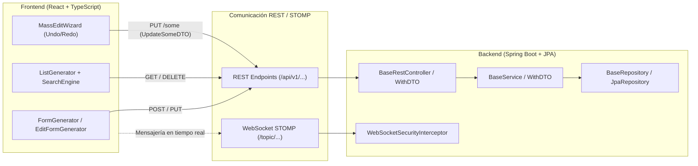
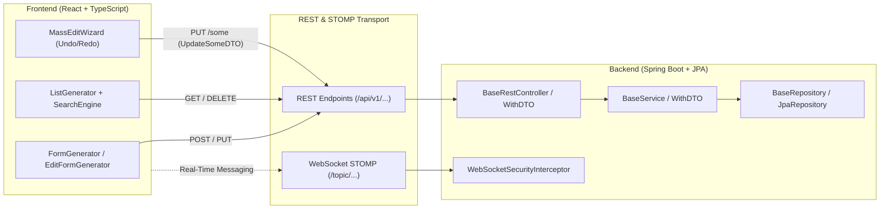

<div align="center">

# ⚡ Spring-React CRUD Toolkit & Accelerator

**A full-stack development accelerator and component toolkit for Spring Boot & React.**

[🇪🇸 Versión en Español](#-versión-en-español) &nbsp;|&nbsp; [🇬🇧 English Version](#-english-version)

</div>

---

# 🇪🇸 Versión en Español

Un ecosistema integral y fuertemente tipado desarrollado en **Spring Boot 3 (Java 21)** y **React 18 (TypeScript)**, diseñado para acelerar drásticamente el desarrollo de aplicaciones web empresariales, reduciendo el código repetitivo (*boilerplate*) en más de un 75% sin sacrificar el rendimiento, la arquitectura limpia ni la seguridad.

---

## 📑 Tabla de Contenidos (Español)
1. [Visión General de la Arquitectura Full-Stack](#1-visión-general-de-la-arquitectura-full-stack)
2. [Sinergia End-to-End: Contrato Cliente-Servidor](#2-sinergia-end-to-end-contrato-cliente-servidor)
3. [Capa Backend: Componentes Genéricos y Seguridad](#3-capa-backend-componentes-genéricos-y-seguridad)
   - [3.1. BaseRepository y Patrón DTO](#31-baserepositoryt-d-i)
   - [3.2. BaseService y Hooks de Seguridad Opcionales](#32-baseservicet-i-y-patrón-template-method)
   - [3.3. BaseRestController y Edición Masiva (UpdateSomeDTO)](#33-baserestcontroller-y-updatesomedto)
   - [3.4. Seguridad en Tiempo Real: WebSocketSecurityInterceptor](#34-seguridad-en-tiempo-real-websocketsecurityinterceptor)
4. [Capa Frontend: Generadores Dinámicos de UI](#4-capa-frontend-generadores-dinámicos-de-ui)
   - [4.1. FormGenerator vs Formik (Eficiencia y Re-renders)](#41-formgenerator-vs-formik)
   - [4.2. EditFormGenerator (Inferencia Automática de Esquemas)](#42-editformgenerator)
   - [4.3. ListGenerator vs TanStack Table y AG Grid](#43-listgenerator-vs-tanstack-table-y-ag-grid)
   - [4.4. MassEditWizard (Flujo Transaccional con Undo/Redo)](#44-masseditwizard)
   - [4.5. SearchBar & SearchEngine (Caché LRU y Búsqueda Avanzada)](#45-searchbar--searchengine)
   - [4.6. DoNotHackMyApp / RouteGuard](#46-donothackmyapp--routeguard)
   - [4.7. ButtonLink (Navegación Limpia)](#47-buttonlink)
5. [Pruebas Automatizadas y Calidad](#5-pruebas-automatizadas-y-calidad)
6. [Licencia, Autoría y Propiedad Intelectual](#6-licencia-autoría-y-propiedad-intelectual)

---

## 1. Visión General de la Arquitectura Full-Stack

El framework resuelve el ciclo completo de los datos empresariales:



---

## 2. Sinergia End-to-End: Contrato Cliente-Servidor

A diferencia de librerías aisladas de frontend o backend, este framework define un **protocolo sincronizado**:

* **Edición Masiva en Lote:** `MassEditWizard.tsx` permite al usuario modificar múltiples filas con control de versiones en memoria. Al confirmar, envía una petición `PUT /some` con el payload `{ ids: [...], entities: [...] }`.
* **Procesamiento Transaccional:** `BaseRestController.java` recibe exactamente esa estructura mediante `UpdateSomeDTO<I, T>`, y `BaseService.java` ejecuta la actualización en una única transacción atómica (`@Transactional`).

---

## 3. Capa Backend: Componentes Genéricos y Seguridad

### 3.1. `BaseRepository<T, D, I>`
Extensión de `JpaRepository<T, I>` con soporte nativo de proyecciones DTO:
* `List<D> findAllAsDTO()`: Consultas directas optimizadas que evitan la sobrecarga de hidratación JPA.
* `Optional<D> findByIdAsDTO(I id)`: Búsqueda individual desacoplada del modelo de base de datos.

### 3.2. `BaseService<T, I>` y Patrón Template Method
Servicio base transaccional (`@Transactional`) con operaciones CRUD completas y soporte para **hooks de seguridad y validación opcionales**:

```java
public abstract class BaseService<T, I> {
    // Hooks opcionales extensibles en servicios hijos según reglas de negocio
    protected void checkReadSecurity(I id) {}
    protected void checkCreateSecurity(T entity) {}
    protected void checkUpdateSecurity(I id, T entity) {}
    protected void checkDeleteSecurity(I id) {}

    @Transactional(readOnly = true)
    public T findById(I id) {
        checkReadSecurity(id);
        return this.findOrResourceNotFoundException(this.repository.findById(id), "ID", id);
    }

    @Transactional
    public List<T> updateSome(@Valid List<I> ids, @Valid List<T> updatedEntities) {
        if (ids.size() != updatedEntities.size()) {
            throw new IllegalArgumentException("Ids and entities size mismatch");
        }
        List<T> toSave = new ArrayList<>();
        for (int i = 0; i < ids.size(); i++) {
            T existing = this.findById(ids.get(i));
            updateEntityFields(existing, updatedEntities.get(i));
            toSave.add(existing);
        }
        return this.repository.saveAll(toSave);
    }
}
```

### 3.3. `BaseRestController` y `UpdateSomeDTO`
Expone endpoints estandarizados de forma automática:
* `GET /`: Listado completo.
* `GET /{id}`: Búsqueda por identificador con control de `ResourceNotFoundException`.
* `POST /`: Creación con código `HTTP 201 Created`.
* `PUT /{id}`: Actualización individual.
* `PUT /some`: Actualización por lotes recibiendo `UpdateSomeDTO<I, T>`.
* `DELETE /{id}`: Borrado físico con `HTTP 204 No Content`.

Las variantes `BaseServiceWithDTO` y `BaseRestControllerWithDTO` permiten desacoplar completamente la capa de persistencia de la capa de transporte mediante `EntityMapper<T, D>`.

### 3.4. Seguridad en Tiempo Real: `WebSocketSecurityInterceptor`
Componente crítico basado en `ChannelInterceptor` para asegurar el canal STOMP / WebSocket (frecuentemente desprotegido en aplicaciones web):
1. **Autenticación en Handshake (`CONNECT`):** Valida tokens JWT Bearer presentes en las cabeceras nativas antes de permitir la sesión WebSocket y establece el `SecurityContextHolder`.
2. **Defensa contra DoS (`Rate Limiting`):** Implementa un contador atómico por ventana de tiempo (`AtomicInteger` + `ConcurrentHashMap`) limitando el tráfico por usuario (máximo 60 msg/min) para evitar saturación del broker.
3. **Control de Tamaño de Payload:** Rechaza mensajes superiores a 64 KB previniendo ataques de agotamiento de memoria o inyección masiva.
4. **Validación de Rutas:** Verifica destinos (`/topic/...`) y valida que los identificadores de ruta sean numéricos.

---

## 4. Capa Frontend: Generadores Dinámicos de UI

### 4.1. FormGenerator vs Formik
* **Rendimiento:** Formik maneja el estado de cada input en React State, re-renderizando todo el formulario en **cada tecla pulsada**. `FormGenerator` se basa en **React Hook Form** (referencias no controladas y suscripciones aisladas), manteniendo cero re-renders innecesarios.
* **Eliminación de Boilerplate:** El formulario se describe mediante un array declarativo `FieldDef[]` en lugar de decenas de etiquetas JSX manuales.

```tsx
const userFields: FieldDef[] = [
  { tag: 'Nombre de usuario', name: 'username', type: 'text', isRequired: true },
  { tag: 'Email', name: 'email', type: 'email', isRequired: true },
  { tag: 'Rol', name: 'role', type: 'select', values: ['PLAYER', 'ADMIN'] }
];

<FormGenerator<UserFormData>
  fields={userFields}
  defaultValues={{ username: '', email: '', role: 'PLAYER' }}
  onSubmit={handleSubmit}
  submitText="Guardar"
/>
```

### 4.2. EditFormGenerator
Detecta automáticamente el tipo de dato de las entidades (texto, numérico, booleano/checkbox, fecha, select, password, email) mediante introspección (`buildFieldsFromEntity`), creando el formulario de edición sin requerir configuración manual de campos.

### 4.3. ListGenerator vs TanStack Table y AG Grid
* Frente a **TanStack Table** (que es 100% *headless* y exige programar toda la UI desde cero), `ListGenerator` proporciona una interfaz interactiva lista para producción.
* Frente a **AG Grid** (cuyo bundle es muy pesado y exige licencias de pago para edición avanzada), `ListGenerator` es ligero y aporta su propio asistente de edición en lote.

### 4.4. MassEditWizard
Permite navegar y editar de forma guiada una colección de registros seleccionados:
* Historial con pila de **Undo / Redo** por cada entidad (`EditTuple<T>`).
* Comparación de estados (`hasChanges`) para evitar tráfico innecesario.
* Modal de revisión comparativa (`ReviewModal`) previa al envío al endpoint `/some`.
* Atajos de teclado: `Ctrl + A` para seleccionar los registros visibles de la página y `Escape` para cancelar el asistente.

### 4.5. SearchBar & SearchEngine
Motor de búsqueda en cliente desacoplado y de alto rendimiento:
* Soporta **rutas anidadas** (`player.profile.nickname`).
* Operadores lógicos `AND` / `OR` y modos de coincidencia (`contains`, `exact`, `startsWith`).
* Optimización con **Caché LRU** (`cacheCapacity = 200`) y **Debounce** (`300ms`).

### 4.6. DoNotHackMyApp / RouteGuard
Interrumpe la renderización de vistas si el usuario no cuenta con los roles o autoridades requeridas, redirigiendo de forma transparente a la pantalla de acceso no autorizado.

### 4.7. ButtonLink
Micro-componente utilitario que unifica un botón Reactstrap con la navegación SPA de React Router en una sola línea limpia.

---

## 5. Pruebas Automatizadas y Calidad

El toolkit destaca por un compromiso riguroso con la calidad y la fiabilidad del software, respaldado por un total de **193 pruebas automatizadas (70 en Backend + 123 en Frontend)** que cubren unitariamente y en integración cada capa arquitectónica:

| Capa | Archivos / Suites | Tests Automatizados | Tecnologías Clave | Cobertura Funcional |
| :--- | :---: | :---: | :--- | :--- |
| **☕ Backend** | 7 suites (+ 8 fixtures) | **70 tests** | JUnit 5, Mockito, AssertJ, Spring MockMvc, JPA | Ciclo CRUD, transaccionalidad, DTOs y validadores |
| **⚛️ Frontend** | 16 suites | **123 tests** | Jest / Vitest, React Testing Library, User Event | Formularios, tablas, wizards, búsqueda y seguridad |
| **🏆 TOTAL** | **23 suites** | **193 tests** | *Stack Unificado Spring Boot + React* | **Cobertura integral End-to-End** |


### ☕ Pruebas en Backend (**70 tests** | JUnit 5, Mockito, AssertJ, Spring MockMvc)
Ubicadas en `backend/src/test/java/toolkit/model/`, estas pruebas utilizan un conjunto de fixtures dedicados (`dummy/`) para verificar la jerarquía genérica de forma 100% desacoplada de entidades de negocio:
* **`BaseServiceTest.java` (26 tests):** Validación exhaustiva del ciclo de vida CRUD, control de excepciones `ResourceNotFoundException`, transaccionalidad, métodos hook del patrón Template Method y la lógica atómica de `updateSome` (comprobación de paridad de tamaños, actualización campo a campo y persistencia masiva).
* **`BaseRestControllerTest.java` (14 tests):** Pruebas de integración HTTP mediante MockMvc validando códigos de respuesta (`200 OK`, `201 Created`, `204 No Content`, `404 Not Found`) y el contrato del endpoint `@PutMapping("/some")` con `UpdateSomeDTO`.
* **`BaseRestControllerWithDTOTest.java` (10 tests):** Verificación de endpoints desacoplados mediante DTOs y mappers.
* **`BaseServiceWithDTOTest.java` (10 tests):** Pruebas de mapeo bidireccional DTO-Entidad en operaciones de lectura y guardado.
* **`BaseRepositoryTest.java` (5 tests):** Pruebas de persistencia JPA y proyecciones directas a DTO sin hidratación de entidades.
* **`ModelAndValidatorTest.java` & `ValidatorTests.java` (5 tests):** Validación declarativa de restricciones Jakarta / Hibernate Validator sobre el modelo.

### ⚛️ Pruebas en Frontend (**123 tests** | Jest / Vitest, React Testing Library, User Event)
Ubicadas junto a cada componente en `frontend/src/components/`, cubriendo comportamiento de usuario, accesibilidad y lógica algorítmica:
* **Generación y Manipulación de Listas (48 tests):**
  * `ListGeneratorHelper.test.tsx` (18 tests): Lógica de renderizado, selección masiva, filtrado y helpers.
  * `ListGenerator.Behaviour.test.tsx` (14 tests): Pruebas de interacción con el usuario, selección múltiple y atajos de teclado (`Ctrl + A`, `Escape`).
  * `ListGenerator.test.tsx` (9 tests): Renderizado de columnas, botones de acción y estado visual.
  * `ListGenerator.Matrix.test.tsx` (7 tests): Soporte de matrices de datos heterogéneas y esquemas dinámicos.
* **Ordenación y Paginación (14 tests):**
  * `ListSortBar.test.tsx` (9 tests): Ordenación por columnas ascendente/descendente y cambio dinámico de campos.
  * `ListPagination.test.tsx` (5 tests): Navegación entre páginas, límites y reseteo automático al aplicar filtros.
* **Asistente de Edición Masiva (9 tests):**
  * `MassEditWizard.test.tsx` (6 tests): Flujo paso a paso, pila transaccional de versiones (**Undo / Redo**), detección de cambios reales (`hasChanges`) y envío por lotes.
  * `ReviewModal.test.tsx` (3 tests): Comparativa visual de diferencias (diff) antes de confirmar cambios.
* **Motor de Búsqueda Client-Side (22 tests):**
  * `SearchBar.test.tsx` (11 tests): Renderizado visual, debounce en tiempo real e interacción.
  * `searchEngine.test.ts` (8 tests): Algoritmos de coincidencia (`contains`, `exact`, `startsWith`), operadores lógicos `AND` / `OR`, resolución de rutas anidadas (`a.b.c`) y sensibilidad a mayúsculas/acentos.
  * `useSearchEngine.test.ts` (3 tests): Comportamiento de la caché LRU en memoria y retardo de escritura.
* **Formularios Dinámicos y Esquemas (22 tests):**
  * `FormInput.test.tsx` (9 tests): Renderizado de inputs (texto, número, select, checkbox, fecha, email, password) y vinculación con React Hook Form.
  * `FormGenerator.test.tsx` (8 tests): Validación de esquemas declarativos `FieldDef[]`, manejo de errores y envíos sin re-renders innecesarios.
  * `EditFormGenerator.test.tsx` (5 tests): Inferencia automática de campos a partir de entidades y mapeo de opciones.
* **Seguridad y Navegación (8 tests):**
  * `DoNotHackMyAppHelper.test.ts` (6 tests): Evaluación de roles y autoridades (`roles[0]`, `Authority.ADMIN`) con redirección automática ante accesos no autorizados.
  * `ButtonLink.test.tsx` (2 tests): Integración estilizada de botones Reactstrap y navegación SPA con React Router.

---

## 6. Licencia, Autoría y Propiedad Intelectual

### Autoría
* **Autor Original:** Ignacio Gutiérrez Serrera
* **GitHub:** [@Ignacio0407](https://github.com/Ignacio0407)
* **Contacto:** [ignaciogutierrezserrera@gmail.com](mailto:ignaciogutierrezserrera@gmail.com)

### Términos de Licencia (Uso No Comercial / Educativo)
* **Uso permitido gratuito:** Se autoriza libremente el uso, copia, estudio y adaptación de este software exclusivamente para **fines personales, académicos, de investigación o demostración en portfolios sin ánimo de lucro**, con la obligación de mantener visible el reconocimiento explícito al autor original.
* **Restricción comercial:** Queda terminantemente prohibido cualquier uso comercial, integración en software privativo o monetización por parte de consultoras o empresas sin la **autorización previa por escrito del autor y la adquisición de una licencia comercial**.
* Para consultas de licenciamiento comercial o contratación: contactar a `ignaciogutierrezserrera@gmail.com`.

---
---

# 🇬🇧 English Version

A comprehensive, strongly typed full-stack ecosystem built with **Spring Boot 3 (Java 21)** and **React 18 (TypeScript)**, designed to dramatically speed up enterprise web application development by cutting down repetitive boilerplate code by over 75% without sacrificing performance, clean architecture, or security.

---

## 📑 Table of Contents (English)
1. [Full-Stack Architecture Overview](#1-full-stack-architecture-overview)
2. [End-to-End Synergy: Client-Server Contract](#2-end-to-end-synergy-client-server-contract)
3. [Backend Layer: Generic Components & Security](#3-backend-layer-generic-components--security)
   - [3.1. BaseRepository & DTO Pattern](#31-baserepositoryt-d-i-1)
   - [3.2. BaseService & Template Method Security Hooks](#32-baseservicet-i--template-method-security-hooks)
   - [3.3. BaseRestController & Batch Editing (UpdateSomeDTO)](#33-baserestcontroller--updatesomedto)
   - [3.4. Real-Time Security: WebSocketSecurityInterceptor](#34-real-time-security-websocketsecurityinterceptor)
4. [Frontend Layer: Dynamic UI Generators](#4-frontend-layer-dynamic-ui-generators)
   - [4.1. FormGenerator vs Formik (Efficiency & Re-renders)](#41-formgenerator-vs-formik-1)
   - [4.2. EditFormGenerator (Automatic Schema Inference)](#42-editformgenerator-1)
   - [4.3. ListGenerator vs TanStack Table & AG Grid](#43-listgenerator-vs-tanstack-table--ag-grid)
   - [4.4. MassEditWizard (Transactional Flow with Undo/Redo)](#44-masseditwizard-1)
   - [4.5. SearchBar & SearchEngine (LRU Cache & Advanced Search)](#45-searchbar--searchengine-1)
   - [4.6. DoNotHackMyApp / RouteGuard](#46-donothackmyapp--routeguard-1)
   - [4.7. ButtonLink (Clean Navigation)](#47-buttonlink-1)
5. [Automated Testing & Code Quality](#5-automated-testing--code-quality)
6. [License, Authorship & Intellectual Property](#6-license-authorship--intellectual-property)

---

## 1. Full-Stack Architecture Overview

The framework orchestrates the full lifecycle of enterprise entity data:



---

## 2. End-to-End Synergy: Client-Server Contract

Unlike isolated frontend components or backend libraries, this framework establishes a **coordinated, protocol-driven contract**:

* **Batch Editing:** `MassEditWizard.tsx` guides the user through multi-item edits with client-side version history. Upon confirmation, it dispatches a single `PUT /some` request with the payload `{ ids: [...], entities: [...] }`.
* **Transactional Execution:** `BaseRestController.java` maps this payload to `UpdateSomeDTO<I, T>`, and `BaseService.java` persists the changes in a single atomic transaction (`@Transactional`).

---

## 3. Backend Layer: Generic Components & Security

### 3.1. `BaseRepository<T, D, I>`
Extends Spring Data `JpaRepository<T, I>` with out-of-the-box DTO projection methods:
* `List<D> findAllAsDTO()`: Optimized queries that bypass JPA entity hydration overhead.
* `Optional<D> findByIdAsDTO(I id)`: Single entity lookups decoupled from the persistence model.

### 3.2. `BaseService<T, I>` & Template Method Security Hooks
Transactional base service providing full CRUD operations along with **optional extensible security hooks**:

```java
public abstract class BaseService<T, I> {
    // Optional hook methods to be overridden by child services according to domain rules
    protected void checkReadSecurity(I id) {}
    protected void checkCreateSecurity(T entity) {}
    protected void checkUpdateSecurity(I id, T entity) {}
    protected void checkDeleteSecurity(I id) {}

    @Transactional(readOnly = true)
    public T findById(I id) {
        checkReadSecurity(id);
        return this.findOrResourceNotFoundException(this.repository.findById(id), "ID", id);
    }

    @Transactional
    public List<T> updateSome(@Valid List<I> ids, @Valid List<T> updatedEntities) {
        if (ids.size() != updatedEntities.size()) {
            throw new IllegalArgumentException("Ids and entities size mismatch");
        }
        List<T> toSave = new ArrayList<>();
        for (int i = 0; i < ids.size(); i++) {
            T existing = this.findById(ids.get(i));
            updateEntityFields(existing, updatedEntities.get(i));
            toSave.add(existing);
        }
        return this.repository.saveAll(toSave);
    }
}
```

### 3.3. `BaseRestController` & `UpdateSomeDTO`
Exposes standardized RESTful endpoints automatically:
* `GET /`: Retrieve all entities.
* `GET /{id}`: Retrieve by ID with automated `ResourceNotFoundException` handling.
* `POST /`: Create resource with `HTTP 201 Created`.
* `PUT /{id}`: Update individual entity.
* `PUT /some`: Bulk update via `UpdateSomeDTO<I, T>`.
* `DELETE /{id}`: Physical deletion with `HTTP 204 No Content`.

The `BaseServiceWithDTO` and `BaseRestControllerWithDTO` variants allow total decoupling of database models from network payloads using `EntityMapper<T, D>`.

### 3.4. Real-Time Security: `WebSocketSecurityInterceptor`
A crucial `ChannelInterceptor` safeguarding the STOMP / WebSocket channel (frequently neglected in web architectures):
1. **Handshake Authentication (`CONNECT`):** Intercepts and cryptographically validates JWT Bearer tokens from native headers, establishing the `SecurityContextHolder`.
2. **Anti-DoS Rate Limiting:** Implements concurrent atomic bucket tracking (`AtomicInteger` + `ConcurrentHashMap`), limiting traffic per user (maximum 60 messages/min) to prevent broker saturation.
3. **Payload Size Guard:** Rejects frames exceeding 64 KB, mitigating memory exhaustion or buffer overflow vectors.
4. **Route Destination Guard:** Verifies `/topic/...` destinations and enforces numerical constraints on resource parameters.

---

## 4. Frontend Layer: Dynamic UI Generators

### 4.1. FormGenerator vs Formik
* **Performance:** Formik keeps input state in React component state, causing full form re-renders on **every single keystroke**. `FormGenerator` leverages **React Hook Form** (uncontrolled ref subscriptions), maintaining optimal zero-re-render typing performance.
* **Zero Boilerplate:** Forms are declaratively generated from a `FieldDef[]` configuration array instead of dozens of manual JSX tags.

```tsx
const userFields: FieldDef[] = [
  { tag: 'Username', name: 'username', type: 'text', isRequired: true },
  { tag: 'Email', name: 'email', type: 'email', isRequired: true },
  { tag: 'Role', name: 'role', type: 'select', values: ['PLAYER', 'ADMIN'] }
];

<FormGenerator<UserFormData>
  fields={userFields}
  defaultValues={{ username: '', email: '', role: 'PLAYER' }}
  onSubmit={handleSubmit}
  submitText="Save"
/>
```

### 4.2. EditFormGenerator
Introspects entity objects automatically (`buildFieldsFromEntity`) to infer input types (text, number, boolean/checkbox, date, select, password, email), generating full edit views with zero manual field mapping.

### 4.3. ListGenerator vs TanStack Table & AG Grid
* Compared to **TanStack Table** (purely headless, requiring hundreds of lines of UI markup from scratch), `ListGenerator` delivers a complete, production-ready interactive table.
* Compared to **AG Grid** (heavy bundle footprint and high licensing fees for transactional features), `ListGenerator` is lightweight and includes a built-in step-by-step batch edit wizard.

### 4.4. MassEditWizard
Guided step-by-step editing for selected collections of records:
* Version history with an **Undo / Redo** stack per record (`EditTuple<T>`).
* Dirty-checking (`hasChanges`) to eliminate redundant network payloads.
* Pre-flight diff modal (`ReviewModal`) before dispatching batch updates to `/some`.
* Keyboard shortcuts: `Ctrl + A` to toggle all visible rows, `Escape` to dismiss the wizard.

### 4.5. SearchBar & SearchEngine
A decoupled, high-performance client-side search engine:
* Supports **nested object properties** (`player.profile.nickname`).
* Logical operators (`AND` / `OR`) and matching modes (`contains`, `exact`, `startsWith`).
* Optimized with **LRU In-Memory Caching** (`cacheCapacity = 200`) and **Debounce** (`300ms`).

### 4.6. DoNotHackMyApp / RouteGuard
Halts view rendering and performs automatic redirection if the authenticated user lacks required roles or authorities.

### 4.7. ButtonLink
A clean micro-component uniting Reactstrap button styling with React Router SPA navigation in a single line.

---

## 5. Automated Testing & Code Quality

The toolkit demonstrates an exceptional commitment to software reliability and quality, backed by a total of **193 automated tests (70 Backend + 123 Frontend)** covering each architectural layer at both the unit and integration levels:

| Layer | Files / Suites | Automated Tests | Core Technologies | Functional Coverage |
| :--- | :---: | :---: | :--- | :--- |
| **☕ Backend** | 7 suites (+ 8 fixtures) | **70 tests** | JUnit 5, Mockito, AssertJ, Spring MockMvc, JPA | Full CRUD lifecycle, transactions, DTOs & validators |
| **⚛️ Frontend** | 16 suites | **123 tests** | Jest / Vitest, React Testing Library, User Event | Forms, interactive tables, wizards, search & security |
| **🏆 TOTAL** | **23 suites** | **193 tests** | *Unified Spring Boot + React Stack* | **Complete End-to-End Coverage** |


### ☕ Backend Tests (**70 tests** | JUnit 5, Mockito, AssertJ, Spring MockMvc)
Located in `backend/src/test/java/toolkit/model/`, using dedicated test fixtures (`dummy/`) to verify generic base abstractions in complete isolation from concrete business entities:
* **`BaseServiceTest.java` (26 tests):** Comprehensive verification of the CRUD lifecycle, `ResourceNotFoundException` handling, transactionality, Template Method hook execution, and atomic batch updates via `updateSome` (size mismatch validation, field-by-field updates, and batch persistence).
* **`BaseRestControllerTest.java` (14 tests):** MockMvc integration tests validating HTTP status codes (`200 OK`, `201 Created`, `204 No Content`, `404 Not Found`) and the `@PutMapping("/some")` batch contract with `UpdateSomeDTO`.
* **`BaseRestControllerWithDTOTest.java` (10 tests):** End-to-end verification of controller endpoints decoupled with DTOs and entity mappers.
* **`BaseServiceWithDTOTest.java` (10 tests):** Bidirectional DTO-to-Entity mapping across read and write operations.
* **`BaseRepositoryTest.java` (5 tests):** JPA persistence queries and direct DTO projections avoiding full entity hydration.
* **`ModelAndValidatorTest.java` & `ValidatorTests.java` (5 tests):** Declarative Jakarta / Hibernate Validator constraint enforcement.

### ⚛️ Frontend Tests (**123 tests** | Jest / Vitest, React Testing Library, User Event)
Colocated with components in `frontend/src/components/`, validating user behavior, accessibility, and algorithmic correctness:
* **List Generation & Table Interactions (48 tests):**
  * `ListGeneratorHelper.test.tsx` (18 tests): Core rendering logic, bulk selection helpers, and data transformations.
  * `ListGenerator.Behaviour.test.tsx` (14 tests): User interaction flows, keyboard shortcuts (`Ctrl + A`, `Escape`), and multi-row selection.
  * `ListGenerator.test.tsx` (9 tests): Dynamic column rendering, custom action buttons, and visual state management.
  * `ListGenerator.Matrix.test.tsx` (7 tests): Heterogeneous data matrices and dynamic entity schemas.
* **Sorting & Pagination (14 tests):**
  * `ListSortBar.test.tsx` (9 tests): Ascending/descending column sorting and active field toggles.
  * `ListPagination.test.tsx` (5 tests): Page navigation, boundary conditions, and automatic reset upon filtering.
* **Mass Edit Wizard (9 tests):**
  * `MassEditWizard.test.tsx` (6 tests): Guided multi-step editing, version-controlled **Undo / Redo** stack, dirty-checking (`hasChanges`), and batch submission.
  * `ReviewModal.test.tsx` (3 tests): Pre-flight visual diffing comparing original vs. modified entity values.
* **Client-Side Search Engine (22 tests):**
  * `SearchBar.test.tsx` (11 tests): UI rendering, real-time debounce, and filter input controls.
  * `searchEngine.test.ts` (8 tests): Matching modes (`contains`, `exact`, `startsWith`), logical `AND` / `OR` operators, nested path resolution (`a.b.c`), and diacritics/case sensitivity.
  * `useSearchEngine.test.ts` (3 tests): In-memory LRU cache eviction and typing debounce timing.
* **Dynamic Forms & Schema Generation (22 tests):**
  * `FormInput.test.tsx` (9 tests): Input field rendering (text, number, select, checkbox, date, email, password) and React Hook Form integration.
  * `FormGenerator.test.tsx` (8 tests): Declarative `FieldDef[]` schemas, error triggering, and submit handling without extraneous re-renders.
  * `EditFormGenerator.test.tsx` (5 tests): Automated entity introspection and dynamic select option binding.
* **Security & Navigation (8 tests):**
  * `DoNotHackMyAppHelper.test.ts` (6 tests): Role and authority evaluation (`roles[0]`, `Authority.ADMIN`) with automatic unauthorized redirection.
  * `ButtonLink.test.tsx` (2 tests): Styled Reactstrap buttons coupled with React Router SPA navigation.

---

## 6. License, Authorship & Intellectual Property

### Authorship
* **Original Author:** Ignacio Gutiérrez Serrera
* **GitHub:** [@Ignacio0407](https://github.com/Ignacio0407)
* **Contact:** [ignaciogutierrezserrera@gmail.com](mailto:ignaciogutierrezserrera@gmail.com)

### License Terms (Non-Commercial / Educational Use)
* **Free Permitted Use:** Permission is granted to inspect, study, copy, and adapt this software exclusively for **personal development, academic, university, scientific research, or non-commercial portfolio demonstration purposes**, provided that explicit credit and authorship attribution are maintained.
* **Commercial Restrictions:** Any commercial exploitation, incorporation into closed-source or proprietary software, or monetization by companies/consultancies is strictly prohibited without **prior explicit written permission and the acquisition of a commercial license from the author**.
* For commercial licensing, enterprise inquiries, or hiring: contact `ignaciogutierrezserrera@gmail.com`.
